# Academic RAG Assistant

A Retrieval-Augmented Generation (RAG) assistant that answers students' academic questions using **only** the official UniFBV handbooks, always citing the **document and page** it relied on, and refusing deterministically when the answer is not in the documents.

## The problem

Academic rules (internship requirements, elective vs. optional courses, enrollment deadlines, minimum workload) are spread across long institutional PDFs. Students either don't find the right page or ask someone and get an unofficial, sometimes wrong, answer. A generic chatbot makes this worse: it answers confidently from general internet knowledge, which may contradict UniFBV's own rules.

## The solution

- **Grounded answers only.** The official PDFs are split into chunks, embedded and stored in PostgreSQL + pgvector. For each question, the closest chunks are retrieved and Gemini is instructed to answer **exclusively** from them, with no outside knowledge.
- **Mandatory citations.** Every chunk carries `document` (PDF file name) and `page` metadata from ingestion. The API returns them as `sources`, and the model is told to cite `(document, p. N)`.
- **Deterministic refusal.** If no chunk reaches the similarity threshold, the backend returns *"Não encontrei essa informação nos documentos oficiais da UniFBV."* with empty `sources` **without calling the LLM**. Out-of-scope questions never reach the model, so it cannot make up an answer.
- **Measured, not assumed.** A golden set and evaluation scripts measure answer accuracy, source accuracy and correct refusals across chunking and threshold configurations.

## Architecture

```mermaid
flowchart LR
    subgraph Ingestion["Ingestion (--ingest)"]
        PDF["docs/*.pdf"] --> Reader["PagePdfDocumentReader<br/>1 document per page"]
        Reader --> Clean["Strip NUL chars<br/>skip empty pages"]
        Clean --> Split["TokenTextSplitter<br/>800 tokens + 100 overlap<br/>(within the same page)"]
        Split --> Batch["Batches of 15 chunks<br/>25 s pause (free-tier rate limit)"]
        Batch --> EmbedI["gemini-embedding-001<br/>768 dimensions"]
    end

    EmbedI --> DB[("PostgreSQL 16 + pgvector<br/>HNSW · cosine distance<br/>metadata: document, page")]

    subgraph Question["Question (POST /api/chat)"]
        UI["React UI"] --> API["ChatController"]
        API --> Service["ChatService"]
        Service --> EmbedQ["Embed question"]
        EmbedQ --> Search["similaritySearch<br/>topK = 4, threshold = 0.65"]
        Search --> Decision{"Any chunk<br/>above threshold?"}
        Decision -- "No" --> Refusal["Fixed refusal<br/>sources = []<br/>(LLM not called)"]
        Decision -- "Yes" --> Prompt["System rules +<br/>&lt;contexto&gt; chunks + &lt;pergunta&gt;"]
        Prompt --> LLM["Gemini 2.5 Flash"]
        LLM --> Answer["answer + sources<br/>(document, page, excerpt)"]
    end

    DB <--> Search
    Refusal --> UI
    Answer --> UI
```



### How the similarity threshold works

With `COSINE_DISTANCE`, Spring AI's `PgVectorStore` (2.0.1) runs:

```sql
SELECT *, embedding <=> ? AS distance FROM vector_store
WHERE embedding <=> ? < ?     -- bound to (1 - similarityThreshold)
ORDER BY distance LIMIT ?     -- topK
```

`<=>` is pgvector's cosine distance (`1 - cosine similarity`), and each returned document has `score = 1 - distance`. The threshold is therefore applied **inside the database**, and the refusal rule only has to check for an empty result.

## Tech stack and rationale

| Layer | Choice | Why |
|---|---|---|
| Language | **Java 21** | LTS with records and pattern matching; strongly typed backend that is easy to test. |
| Framework | **Spring Boot 4.1.2** | Auto-configuration, validation, error handling and Testcontainers integration out of the box. |
| AI integration | **Spring AI 2.0.1** | Provider-agnostic `ChatModel`, `EmbeddingModel` and `VectorStore`, plus PDF reader and token splitter, so the RAG pipeline is not tied to one vendor's SDK. |
| LLM | **Gemini 2.5 Flash** | Fast and inexpensive, has a free tier, and handles Portuguese well. |
| Embeddings | **gemini-embedding-001 @ 768 dimensions** | Strong multilingual retrieval quality. The default 3072 dimensions exceed pgvector's 2000-dimension HNSW limit, so 768 is pinned on both sides. |
| Vector DB | **PostgreSQL 16 + pgvector (HNSW, cosine)** | Vectors and metadata live in a regular relational database, with no extra service to run. HNSW gives fast approximate nearest-neighbour search, and cosine suits normalized text embeddings. |
| Frontend | **React + Vite + TypeScript** | Fast dev server, typed API contract (`answer`, `sources`) and component tests with Vitest + Testing Library. |
| Infra / tests | **Docker Compose, JUnit 5, Mockito, Testcontainers, GitHub Actions** | Reproducible local database. The LLM is always mocked in tests, and integration tests run against a real pgvector container. |

## Project structure

```text
academic-rag-assistant/
├── backend/        # Spring Boot API: ingestion/, chat/, cli/ (--ingest), config/
├── frontend/       # React + Vite + TypeScript chat UI
├── docs/           # Official PDFs (not versioned; see scripts/download-docs.sh)
├── eval/
│   ├── golden-set.json   # Questions, expected answers and expected sources
│   └── results/          # Evaluation reports (not versioned)
├── scripts/        # download-docs.sh, run-eval.sh, eval/*.mjs
├── docker-compose.yml
└── .env.example
```

## Running locally

### Prerequisites

- Java 21
- Node.js 20.19+ (CI uses Node 24)
- Docker Desktop
- A Gemini API key from [Google AI Studio](https://aistudio.google.com/apikey)

### 1. Configure the environment

```bash
cp .env.example .env
```

Fill in `POSTGRES_DB`, `POSTGRES_USER`, `POSTGRES_PASSWORD` and `GEMINI_API_KEY`. The backend loads `../.env` automatically, and `.env` is git-ignored.

### 2. Start PostgreSQL + pgvector

```bash
docker compose up -d
docker compose ps    # wait until the container is "healthy"
```

The database listens on `localhost:5434`. The backend creates the `vector_store` table and HNSW index the first time it starts (`spring.ai.vectorstore.pgvector.initialize-schema=true`).

### 3. Get the PDFs

Put the official PDFs in `docs/`, or download the public ones:

```bash
bash scripts/download-docs.sh
```

### 4. Ingest the documents

```bash
cd backend
./mvnw spring-boot:run -Dspring-boot.run.arguments=--ingest
# Windows: .\mvnw.cmd spring-boot:run "-Dspring-boot.run.arguments=--ingest"
```

The log shows pages, empty pages and chunks per file, then a final summary. Because of the free-tier pause between batches, ingestion takes a few minutes. After `Ingestão concluída.` the API keeps running, so you can use it right away or stop it with `Ctrl+C`.

> Re-running ingestion **duplicates** chunks. Clear the table first:
> `docker compose exec postgres psql -U <POSTGRES_USER> -d <POSTGRES_DB> -c "TRUNCATE vector_store;"`

### 5. Run the backend

```bash
cd backend
./mvnw spring-boot:run          # Windows: .\mvnw.cmd spring-boot:run
```

The API is served at `http://localhost:8080`:

```bash
curl -X POST http://localhost:8080/api/chat \
  -H "Content-Type: application/json" \
  -d '{"question": "A partir de qual período posso fazer estágio?"}'
```

### 6. Run the frontend

```bash
cd frontend
npm ci
npm run dev
```

Open `http://localhost:5173`. Set `VITE_API_URL` if the API is not on `http://localhost:8080`.

### Tests

```bash
cd backend && ./mvnw -B verify           # unit + Testcontainers integration tests (needs Docker)
node --test scripts/eval/*.test.mjs      # evaluation metrics
cd frontend && npm ci && npm test        # UI components (Vitest)
```

GitHub Actions runs all three suites on every pull request and on every push to `main`.

## Configuration

| Property | Default | Meaning |
|---|---|---|
| `app.ingestion.docs-dir` | `../docs` | PDF folder, relative to the working directory |
| `app.ingestion.chunk-size` | `800` | Max tokens per chunk |
| `app.ingestion.chunk-overlap` | `100` | Tokens repeated from the previous chunk of the same page |
| `app.ingestion.batch-size` | `15` | Chunks per embedding call |
| `app.ingestion.batch-delay-ms` | `25000` | Pause between batches (`0` in tests) |
| `app.chat.top-k` | `4` | Max chunks retrieved per question |
| `app.chat.similarity-threshold` | `0.65` | Minimum cosine similarity, below which the backend refuses |

Override any property on the command line, for example `-Dspring-boot.run.arguments="--app.chat.similarity-threshold=0.75"`, or with an environment variable, for example `APP_CHAT_SIMILARITY_THRESHOLD=0.75`.

## Evaluation & Chunking Experiment

`eval/golden-set.json` holds answerable questions, each with an expected answer and expected source (`document` = PDF file name, `page`), plus out-of-scope questions with `should_refuse: true`.

```bash
# with the backend running
bash scripts/run-eval.sh --label "chunk800-thr0.65"
# EVAL_DELAY_MS=5000 bash scripts/run-eval.sh ...   # spacing for the Gemini free tier
```

Each run writes `report.json` and `report.md` to `eval/results/<timestamp>/`.

**Metrics:**
- **Source accuracy:** for answerable questions, how often the expected document and page appear in `sources`. Computed automatically.
- **Correct refusal:** for out-of-scope questions, how often the API refused. Computed automatically.
- **Answer accuracy:** how often the answer matches the expected answer. Graded manually from `report.md`.

**Procedure for each round:**
1. Truncate `vector_store`.
2. Re-ingest with the round's `chunk-size`.
3. Start the API with the round's threshold.
4. Run the evaluation and record the numbers below.

| Round | `chunk_size` | `overlap` | `threshold` | Answer accuracy | Source accuracy | Correct refusal | Notes |
|---|---|---|---|---|---|---|---|
| 1 | 800 | 100 | 0.65 | | | | baseline |
| 2 | | | | | | | |
| 3 | | | | | | | |
| 4 | | | | | | | |

**Chosen configuration:** _to be filled_. **Rationale:** _to be filled_.

## AI-Assisted Development

This project was built using **Claude Code** as an AI pair-programming tool for scaffolding, boilerplate, and test generation, while **Renan** designed the RAG architecture, implemented and calibrated the core retrieval and prompt rules, conducted real document ingestion, and owns all debugging and maintenance. All work went through small, focused pull requests, reviewed and validated locally before merge[cite: 12].

| Renan (Author & Maintainer) | Claude Code (AI Pair-Programmer) |
|---|---|
| System architecture and technical decisions (RAG pipeline, stack, deterministic refusal strategy)[cite: 12] | Initial project scaffolding, Docker Compose setup, and GitHub Actions CI configuration[cite: 12] |
| Implementing and calibrating core RAG logic (chunking parameters, similarity threshold, system prompt, prompt-injection guardrails)[cite: 12] | Boilerplate for REST endpoints (`POST /api/chat`), DTOs, CORS, and error handling |
| Running real PDF ingestion, diagnosing production bottlenecks (path resolution, Gemini rate limits, NUL byte sanitization), and fixing bugs | Generating unit and integration test suites (JUnit 5, Mockito, Testcontainers, Vitest, `node --test`)[cite: 12] |
| Building the 30-question golden set answer key, running evaluation rounds, and grading answer accuracy[cite: 8, 9] | Base React + TypeScript UI components and evaluation runner scripts[cite: 12] |
| Reviewing every diff, running local test suites, and maintaining the codebase[cite: 12] | Assisting with documentation drafts under strict repository guardrails |

Repository guardrails enforced during AI-assisted sessions:
- small, reviewable PRs;
- automated tests for all new code, with external LLM calls mocked;
- no secrets, `.env`, or institutional PDFs committed to Git[cite: 8, 12];
- no changes to retrieval logic, system prompts, similarity thresholds, or the golden set without explicit manual validation.

## Current limitations

- **Image-only pages are skipped.** There is no OCR, so scanned pages without extractable text are counted and ignored, and their content cannot be answered.
- **No conversational memory.** Each question is independent, so follow-ups like "and what about the deadline?" lose context.
- **Re-ingestion duplicates chunks.** There is no deduplication or upsert yet, so the table must be truncated manually.
- **Fixed pause between batches.** The rate limiting ignores actual token usage, and there is no retry or backoff on HTTP 429.
- **Some sources may not be used in the answer.** When the model itself declines although some chunk passed the threshold, `sources` is still returned.
- **Prompt-injection mitigation is best-effort.** It relies on delimiters, tag stripping and system instructions, not on a guarantee.

## Next steps

- OCR for image-only pages, e.g. Tesseract or Gemini vision during ingestion.
- Conversational memory, e.g. Spring AI `ChatMemory` with question rewriting before retrieval.
- Idempotent ingestion, using a content hash per chunk or deleting by `document` before re-adding.
- Retry with exponential backoff for embedding rate limits.
- Hybrid search (BM25 + vectors) and re-ranking for better recall on exact terms such as article numbers.
- Dockerize the backend and frontend so the whole stack runs with one `docker compose up`.

## Security

- `.env`, API keys and the PDFs in `docs/` are never committed (see `.gitignore`).
- `.env.example` contains no real credentials.
- Tests never call Gemini, and CI needs no secrets.
